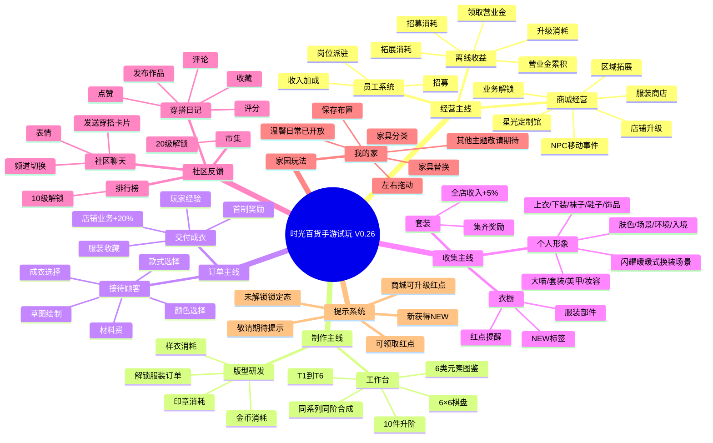
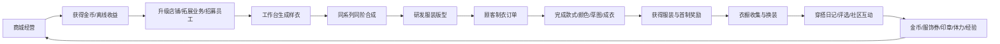
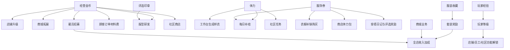
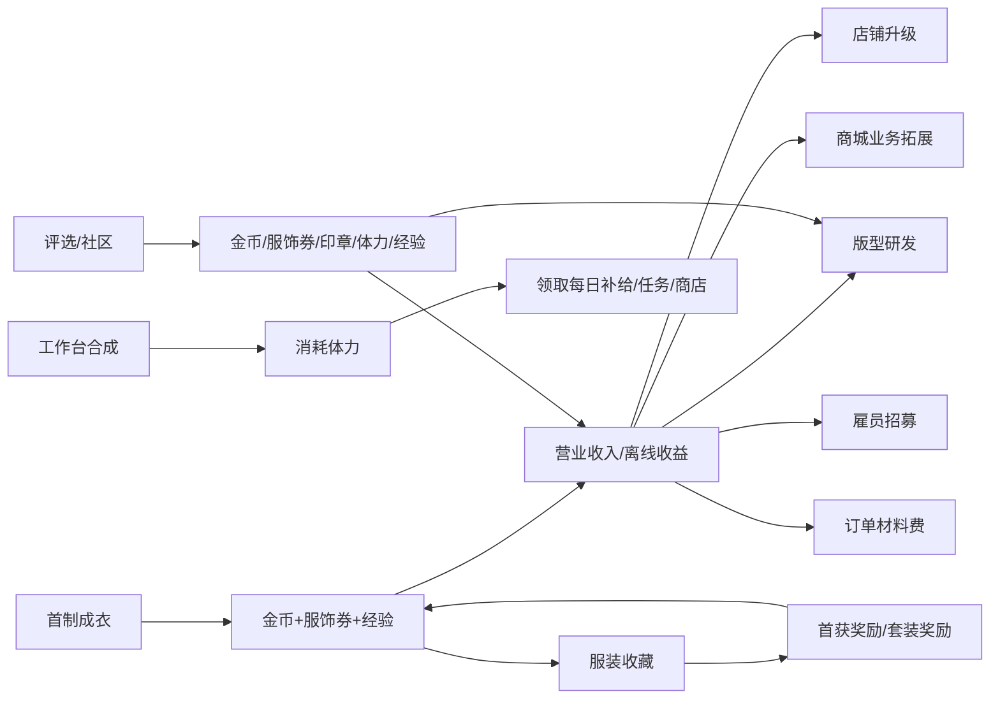

# 《时光百货 / Fashion Studio》玩法思维导图与核心循环数值逻辑

> 版本：V0.27  
> 文档用途：整理当前已完成手游试玩版本的玩法结构、核心循环、系统关系、数值规则和经济出口。  
> 当前实现形态：本地离线试玩，不接入真实多人服务、真实支付或云端排行榜。

---

## 一、产品定位与核心体验

### 一句话定位

以**服装收集**为目标，以**商城经营**提供资源，以**工作台合成与版型研发**提供成长，以**顾客制衣订单**完成服装产出，再通过**穿搭日记 / 社区UGC**获得评选反馈和社交展示的女性向经营换装手游试玩版。

### 核心体验关键词

- 经营：店铺升级、业务拓展、员工派驻、顾客事件。
- 制作：工作台合成样衣，研发服装版型。
- 订单：按顾客要求完成款式、颜色、草图和成衣选择。
- 收集：获得服装、首获奖励、套装奖励、NEW状态。
- 换装：个人形象换装，参考《闪耀暖暖》的场景、分类和操作结构。
- 评选：穿搭日记、评分、点赞、收藏、评论。
- 家园：我的家 / 卧室装修，家具替换和横向浏览。
- 离线：营业收入离线积累，再通过经营升级和商城拓展消耗。

---

## 二、玩法总思维导图



---

## 三、核心循环逻辑

### 1. 30秒理解版循环



### 2. 单次订单闭环

```text
选择已研发版型
  ↓
支付订单材料费
  ↓
选择顾客要求的服装类型
  ↓
选择顾客要求的服装颜色
  ↓
完成草图或使用辅助草图
  ↓
选择正确成衣
  ↓
交付顾客
  ↓
获得金币、服饰券、经验、服装收藏
  ↓
店铺新增业务收入
```

### 3. 首轮新手闭环

当前系统通过 `loopSteps()` 判定首轮闭环，必须完成：

1. 服装商店达到2级；
2. 研发首张版型「粉色披肩礼服」；
3. 完成第一次顾客制衣；
4. 领取对应服装的首获奖励；
5. 完成一次评选 / 穿搭日记投稿。

完成后可领取首轮闭环奖励：

| 奖励 | 数值 |
|---|---:|
| 经营金币 | 2,500 |
| 服饰券 | 25 |
| 体力 | 20 |

---

## 四、系统关系与资源流向



---

## 五、当前基础数值

### 1. 新存档初始状态

| 项目 | 初始值 |
|---|---:|
| 经营金币 | 1,800 |
| 银行营业金 | 0 |
| 服饰券 | 25 |
| 评选印章 | 0 |
| 体力 | 100 / 100 |
| 玩家等级 | 1级 |
| 玩家经验 | 0 |
| 已开放店铺 | 服装商店 |
| 服装商店等级 | 1级 |
| 星光定制馆 | 未开放 |
| 初始服装收藏 | 5件 |
| 工作台 | 6×6，共36格 |
| 初始样衣 | 两摞T1样衣：9+1、9+1 |

### 2. 时间与离线

| 规则 | 数值 |
|---|---:|
| 体力恢复速度 | 每120秒恢复1点 |
| 体力上限 | 100 |
| 离线收益最大结算时长 | 36,000秒，即10小时 |
| 离线收益公式 | `离线秒数 × 当前总秒收入` |
| 营业金领取 | 领取后从银行营业金转入经营金币 |
| 每日刷新 | 以本地日期判断 |

---

## 六、商城经营数值逻辑

### 1. 店铺基础收入

| 店铺 | 初始基础收入 | 每升1级增加 | 开放条件 |
|---|---:|---:|---|
| 服装商店 | 230金币/秒 | +3金币/秒 | 初始开放 |
| 星光定制馆 | 390金币/秒 | +6金币/秒 | 服装商店4级、2张版型、2件首制成衣、4,500金币 |

### 2. 店铺收入公式

```text
单店收入 = [基础收入 + 升级增量 × (店铺等级 - 1)] × (1 + 加成总和)
```

加成总和包括：

```text
已上架成衣数量 × 20%
+ 雇员收入加成
+ 已领取套装数量 × 5%
+ 商城业务加成
```

当前实现中的 `shopIncome(id)` 会将上述加成叠加后计算实际秒收入。

### 3. 店铺升级

- 支持单次升级：1级；
- 支持批量升级：5级、10级；
- 店铺等级上限：1000级；
- 每升1级玩家经验：+20；
- 升级消耗使用商城等级费用曲线，不采用固定线性价格。

商城升级费用使用分段校准曲线：

- 低等级区间：从基础价格逐步增长；
- 中等级区间：向高等级成本平滑过渡；
- 高等级参考点：
  - Lv341附近十级费用约2,676万；
  - Lv695附近十级费用约5.32亿；
  - Lv757附近十级费用约7.10亿。

### 4. 商城业务与拓展

每项已解锁业务默认提供：

```text
+5% 商城业务收入
```

业务拓展容量：

| 区域阶段 | 可容纳业务数量 |
|---:|---:|
| 0 | 12 |
| 1 | 22 |
| 2 | 30 |
| 3 | 38 |
| 4 | 44 |
| 5 | 50 |

业务解锁门槛序列：

```text
1、2、3、4、5、6、8、10、12、14、16、20级
```

拓展条件：

```text
当前区域业务全部满足前置条件
+ 支付拓展费用
+ 店铺处于开放状态
```

拓展费用公式：

```text
拓展费用 = round(12,000 × (63,340,000 / 12,000)^((店铺等级 - 1) / 756))
```

> 该公式是当前试玩版的数值校准曲线，用于形成从前期可负担到中后期高额消耗的经营节奏。

---

## 七、雇员系统数值

### 1. 招募费用与实际收入加成

| 雇员 | 招募费用 | 实际收入加成 | 解锁条件 |
|---|---:|---:|---|
| 米娅 | 900 | +85% | 初始可招募 |
| 叶辰 | 1,400 | +120% | 初始可招募 |
| 莉莉 | 2,400 | +85% | 服装商店3级 |
| 艾琳 | 3,600 | +105% | 服装商店5级 |
| 诺亚 | 6,000 | +120% | 玩家等级12级 |
| 芙雅 | 4,200 | +105% | 开放星光定制馆 |

> 存档兼容旧版加成数据：旧版雇员加成为15%、20%、25%、35%等；新招募使用当前视频化数值表。

### 2. 岗位

每个店铺最多4个岗位：

1. 顾客接待；
2. 货架管理；
3. 会员服务；
4. 收银。

前3个岗位在店铺开放后可用，第4个岗位需要玩家等级12级。

同一雇员不能同时派驻在两个岗位。

---

## 八、工作台合成与版型研发

### 1. 工作台结构

- 6×6棋盘；
- 总格数：36格；
- 3条实际生成链：女装、鞋履、配饰；
- 合成图谱展示：6类参考图元素 × 6阶品质，共36个元素。

参考图元素类别：

```text
发卡、项链、口红、耳坠、香水、包包
```

六阶品质：

```text
T1 普通
T2 稀有
T3 史诗
T4 传说
T5 神话
T6 至尊
```

### 2. 合成规则

```text
同系列 + 同阶 + 两摞样衣
  ↓
数量相加
  ↓
未满10件：继续堆叠
满10件：升为下一阶1件
```

T6为最高阶：

```text
T6 + T6不会继续升阶
T6单摞最多10件
超过上限的数量保留在原格
```

### 3. 初始样衣

新存档初始工作台包含：

- 0号链T1：9件 + 1件；
- 2号链T1：9件 + 1件。

### 4. 生成器

| 生成器 | 体力消耗 | 开放条件 |
|---|---:|---|
| 女装样衣 | 1体力/次 | 初始开放 |
| 鞋履样衣 | 2体力/次 | 开放星光定制馆 |
| 配饰样衣 | 4体力/次 | 服装商店3级 |

生成次数支持：

- 单次生成：1次；
- 批量生成：5次。

生成阶数：

- 研发0～2张版型：基础生成器；
- 研发达到3张版型：生成器等级提升；
- 研发达到8张版型：高阶生成器开放；
- 生成的初始阶数最高不会超过当前生成器等级，并且会随机上浮1阶，最终封顶T6。

### 5. 版型研发

研发消耗：

| 目标服装星级 | 所需样衣 | 金币 | 印章 |
|---:|---:|---:|---:|
| 1/3星 | 1件对应阶样衣 | `600 + (订单序号 mod 5) × 160` | 0 |
| 5星 | 2件对应阶样衣 | 2,600 | 15 |

研发完成：

- 永久解锁对应版型；
- 玩家经验+60；
- 可进入顾客制衣订单；
- 样衣被消耗，不直接获得成衣。

---

## 九、顾客制衣订单逻辑

### 1. 订单状态机

```text
未接单
  ↓ 支付材料费
选择服装类型
  ↓ 校验
选择服装颜色
  ↓ 校验
绘制草图 / 使用辅助草图
  ↓ 校验
选择成衣
  ↓ 校验
交付完成
```

### 2. 订单材料费

| 服装星级 | 接单材料费 |
|---:|---:|
| 非5星 | 180金币 |
| 5星 | 360金币 |

取消订单会退还对应材料费。

### 3. 完成订单奖励

首次制衣：

```text
金币 = 800 + 服装星级 × 150
服饰券 = 12
玩家经验 = 80
永久收藏对应服装
店铺新增一项成衣业务
店铺业务收入 +20%
```

重复制衣：

```text
金币 = 300
服饰券 = 5
每日重复交付奖励最多10次
```

### 4. 颜色校验

订单颜色直接读取服装数据，避免文案与实际资源不匹配。

示例：

```text
粉色披肩礼服 → 顾客要求粉色
```

---

## 十、衣橱、套装与收集奖励

### 1. 首获奖励

- 非5星服装：+5服饰券；
- 5星服装：+15服饰券；
- 首次拥有时产生NEW状态；
- 查看新品后NEW消失；
- 未领取奖励时保留奖励红点。

### 2. 套装奖励

集齐一套服装后领取：

| 奖励 | 数值 |
|---|---:|
| 金币 | 3,000 |
| 服饰券 | 25 |
| 评选印章 | 10 |
| 体力 | 10 |
| 全店收入加成 | +5% |

每套只能领取一次。

---

## 十一、穿搭日记 / 评选与社区UGC

### 1. 评选前置条件

- 至少完成一次顾客制衣；
- 已拥有成衣、鞋履、配饰三个部位；
- 不能使用未拥有服装；
- 免费练习入口已移除。

### 2. 单件服装评分

```text
单件分 = min(100,
  35
  + 9 × 服装星级
  + 20 × 是否命中主题标签1
  + 10 × 是否命中主题标签2
)
```

### 3. 三个评委分数

设三件搭配服装得分为 `p1、p2、p3`：

```text
评委1 = min(100, round((p1 + p2 + p3) / 3))
评委2 = min(100, round(p1 × 0.5 + p2 × 0.25 + p3 × 0.25))
评委3 = min(100, 40 + 12 × 命中主题数量 + round((p1 + p2 + p3) / 15))
总分 = 评委1 + 评委2 + 评委3
```

理论总分上限：300分。

### 4. 评选奖励

每日最多3次奖励参评：

| 奖励 | 数值 |
|---|---:|
| 金币 | 600 |
| 服饰券 | 8 |
| 评选印章 | 5 |
| 体力 | 10 |
| 玩家经验 | 50 |

超过每日3次后仍可发布社区作品，但不再发放评选资源。

### 5. 社区互动

- 点赞：可取消，不产生资源；
- 收藏：可取消，不发放服装；
- 评论：支持本地评论与回复；
- 聊天：支持频道切换、表情和发送穿搭卡片；
- 所有社区数据均保存在本地试玩存档。

### 6. 社区解锁

| 功能 | 解锁条件 |
|---|---:|
| 排行榜 | 玩家等级10级 |
| 市集 | 玩家等级20级 |
| 日常任务 | 初始开放 |
| 商店 | 初始开放 |

---

## 十二、社区任务和商店资源出口

### 1. 日常任务

| 任务 | 条件 | 奖励 |
|---|---|---:|
| 登录游戏 | 进入社区大厅 | +300金币 |
| 完成制衣订单 | 完成1次交付 | +5服饰券 |
| 工作台合成 | 累计合成5次 | +10体力 |
| 社区互动 | 点赞/收藏/评论累计3次 | +3服饰券 |

### 2. 社区商店

| 商品 | 消耗 | 产出 |
|---|---:|---:|
| 每日免费礼包 | 免费，每日1次 | 1,200金币、10服饰券、30体力 |
| 灵感小礼包 | 180金币 | 20服饰券、10体力 |
| 精力补给包 | 80服饰券 | 30体力、5服饰券 |
| 收入加速包 | 320金币 | 2,000营业金、25服饰券 |

---

## 十三、个人信息、换装与家园

### 1. 个人信息

- 头像、昵称、生日、本地ID；
- 角色等级和设计师段位；
- 经验条、收入条、服装收藏数量；
- 每日补给入口和红点；
- 个人房间装饰色调。

### 2. 换装

当前换装场景采用参考《闪耀暖暖》的结构：

- 中央角色展示；
- 左侧相册、摄影棚和工具栏；
- 右侧上衣、下装、袜子、鞋子、饰品、大喵、套装、美甲、妆容、肤色、场景、环境、入境分类；
- 底部保存搭配；
- 相册和摄影棚按钮当前点击提示“敬请期待”；
- 已拆分的角色服装资源可用于当前预制套装展示。

### 3. 我的家

- 温馨日常主题已开放；
- 潮流时尚、高级公寓、原木主义、花语之约当前锁定并提示“敬请期待”；
- 家具分类：套装、地板、墙纸、床具、沙发、桌几、装饰、灯饰；
- 选中家具后先预览，点击保存才写入我的家；
- 场景支持左右拖动；
- 未拥有家具显示锁定态。

---

## 十四、红点与状态反馈系统

### 红点触发

- 每日补给可领取；
- 营业金可领取；
- 商城可升级；
- 订单可交付；
- 评选奖励可领取；
- 套装可领取；
- 新服装获得；
- 新家具获得；
- 社区日常任务可领取。

### 红点清除

- 领取对应奖励；
- 查看新品；
- 完成订单交付；
- 领取套装或评选里程碑；
- 查看并处理对应功能入口。

### NEW规则

```text
首次获得服装/家具 → NEW标签 + 新获得红点
查看物品 → NEW消失
未领取奖励 → 奖励红点继续保留
重复获得已查看物品 → 不重复生成NEW
```

---

## 十五、当前版本的经济闭环



### 经济主要消耗口

1. 店铺升级；
2. 商城区域拓展；
3. 商城业务解锁前置；
4. 雇员招募；
5. 顾客订单材料费；
6. 版型研发金币和印章；
7. 衣橱缺件补购服饰券；
8. 社区商店兑换。

### 经济主要产出口

1. 店铺营业收入；
2. 离线收益；
3. 订单首制与重复交付；
4. 每日补给；
5. 社区任务；
6. 评选奖励；
7. 套装奖励；
8. 首获收藏奖励；
9. 社区商店礼包。

---

## 十六、当前版本的关键设计结论

### 已形成的核心闭环

```text
经营获取金币
→ 工作台合成样衣
→ 研发版型
→ 接待顾客订单
→ 制作并收藏服装
→ 换装展示
→ 穿搭日记与社区反馈
→ 获得资源和经验
→ 回到经营升级
```

### 当前最重要的数值节奏

- 前期用服装商店收入推动升级；
- 工作台用体力限制生产频率；
- 研发用金币、样衣和印章形成多资源门槛；
- 订单用材料费换取服装、经验和业务收入；
- 评选提供印章和资源，形成制作系统的回流；
- 商城升级和业务拓展作为中长期金币消耗；
- 离线收益保证玩家离开游戏后仍有回流动力。

### 当前版本边界

- 多人社区、真实排行榜、真实聊天尚未接入；
- 社区数据为本地UGC模拟；
- 换装部分分类已经完成结构展示，但部分分类仍为试玩提示；
- 工作台参考图已接入6类×6阶元素图鉴，现有经济系统实际生成链仍为3条，以保持已有数值体系稳定。

---

## 十七、主要实现文件

| 系统 | 主要文件 |
|---|---|
| 核心经济、订单、合成、评选 | `D:\garden\fashion-studio\mobile-loop\core.js` |
| 工作台渲染 | `D:\garden\fashion-studio\mobile-loop\mobile-views.js` |
| 工作台元素资源 | `D:\garden\fashion-studio\mobile-loop\pixel-workshop.js`、`assets/work-*.png` |
| 工作台样式 | `D:\garden\fashion-studio\mobile-loop\mobile.css` |
| 商城经营 | `D:\garden\fashion-studio\mobile-loop\mall-core.js`、`mall-v022.js` |
| 雇员系统 | `D:\garden\fashion-studio\mobile-loop\employees-core.js` |
| 社区和聊天 | `D:\garden\fashion-studio\mobile-loop\community-core.js`、`community-hall.js` |
| 个人信息与换装 | `D:\garden\fashion-studio\mobile-loop\profile-core.js`、`profile-ui.js`、`profile.css` |
| 我的家 | `D:\garden\fashion-studio\mobile-loop\home-ui.js`、`home-editor.css` |
| 红点系统 | `D:\garden\fashion-studio\mobile-loop\notice-rules.js` |
| V0.26单文件试玩 | `D:\garden\fashion-studio\fashion-studio-mobile-trial-v26.html` |


---

## V0.27目标与节奏优化补充

本版本根据可玩性评估落实了以下调整：

### 1. 前期目标聚焦

首轮任务继续围绕“完成第一套主题服装”展开，依次引导：

```text
服装商店2级
→ 研发粉色披肩礼服
→ 完成第一次顾客订单
→ 领取首获收藏奖励
→ 发布一次穿搭日记
```

### 2. 6阶合成节奏调整

新的升阶需求为：

| 升阶 | 所需同阶样衣 |
|---|---:|
| T1 → T2 | 10件 |
| T2 → T3 | 10件 |
| T3 → T4 | 8件 |
| T4 → T5 | 6件 |
| T5 → T6 | 4件 |

T6仍为最高阶，溢出样衣会自动保留到额外棋盘格，不直接丢失。

### 3. 前期离线收益分级

| 玩家等级 | 离线收益倍率 |
|---|---:|
| Lv1～5 | 50% |
| Lv6～10 | 75% |
| Lv11+ | 100% |

目标是避免一次长时间离线直接跳过前期店铺升级和首轮订单。
